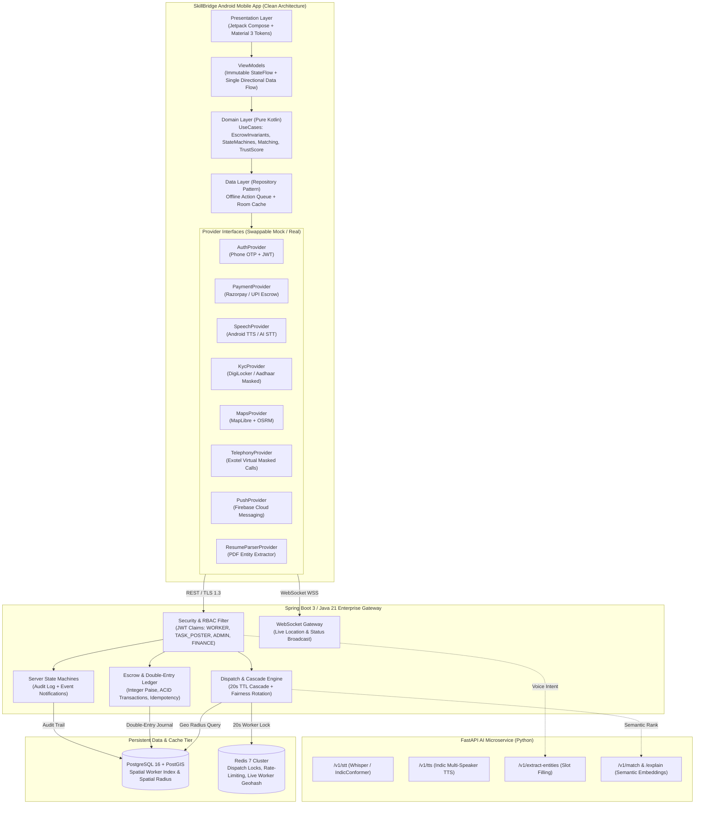
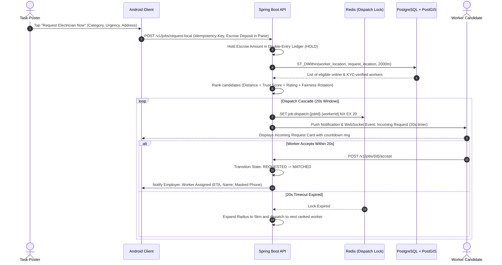
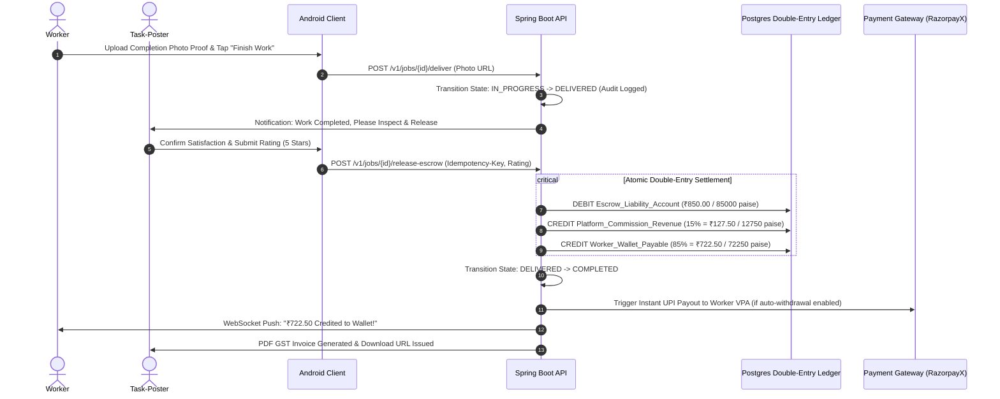
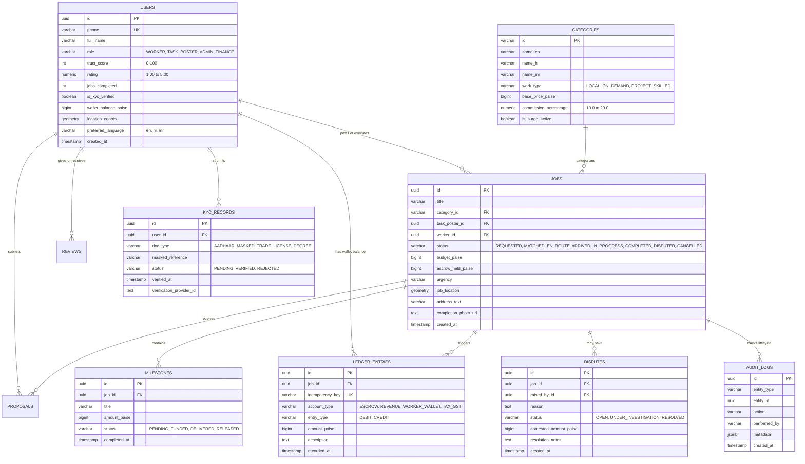

# SkillBridge — Target Production Architecture (WS-0)
**Document Version:** 2.0.0  
**Author:** Principal Product Engineer & Security Architect

---

## 1. High-Level System Architecture Diagram (Mermaid)

---

## 2. Data Flow Diagram: "Request Now" (On-Demand Local Dispatch)

---

## 3. Data Flow Diagram: "Escrow Release" & Financial Settlement

---

## 4. Database Schema (Entity Relationship Diagram)

---

## 5. Architectural Boundaries & Android Clean Layers

1. **Presentation Layer (`com.example.skillbridge.ui`):**
   - Pure UI declaration using Jetpack Compose with strict adherence to design system tokens.
   - All state exposed via `StateFlow` from ViewModels.
   - Zero business or pricing logic inside composables.
   
2. **Domain Layer (`com.example.skillbridge.domain`):**
   - Pure Kotlin (zero `android.*` imports).
   - Contains use-cases: `CalculateTrustScoreUseCase`, `ValidateStateTransitionUseCase`, `ExecuteEscrowLedgerUseCase`, `RankCandidateWorkersUseCase`.
   - Highest test coverage with automated unit tests for state machines and financial invariants.

3. **Data Layer (`com.example.skillbridge.data`):**
   - Implements repositories coordinating local caching (Room) and remote API communication.
   - Provider interface pattern allows switching between `Mock*` (for standalone development/testing) and `Remote*` / `Production*` implementations via configuration.

4. **Security & Invariant Rules:**
   - Client is strictly a presentation and input terminal.
   - Server holds exclusive authority over:
     1. Money balances, fees, and payouts.
     2. Job state transitions and dispute resolution.
     3. Trust scores and KYC validation.
     4. Dispatch algorithm and worker assignment.
